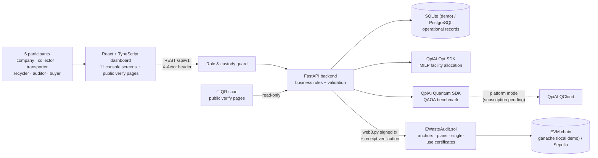

# E-Waste Ledger

**Traceable e-waste recovery across every participant, physical mass-balance auditing, fraud-resistant material claims, and single-use recovery certificates anchored on an EVM blockchain and optimized with QpiAI.**

> Quant-A-Maze 3.0 · Q-BITS × QpiAI · **Web3 & Blockchain track** · Problem statement **WEB3-02: E-Waste Collection, Recovery Yields and Auditable Material Claims**
> Team: `Chaos Coders` · Members: `Poornima H A, Muskhan B S, D Kirthana`

---

## 1. The problem

E-waste moves from companies to collection centres, transporters and licensed recyclers, and recovered material is then sold to buyers. At every handover, quantities can be misreported, shipments can go missing, licences can lapse, and the same recovered material can be claimed, or sold, more than once. Paper and spreadsheet records make independent verification almost impossible.

## 2. The journey we make verifiable

```
🏢 E-waste company → 📦 Collector → 🚚 Transporter → 🏭 Recycler → 🔍 Auditor → 🛒 Material buyer
   declares weight     weighs & passes   confirms pickup    confirms delivery,   counts stock,      verifies & uses
                       it on              & delivers         processes, claims,   reviews alerts     a single-use
                                                             certifies                               certificate
```

Every handover is **weighed by both the sender and the receiver**, so a discrepancy is caught at the exact hop where it happened. Each participant has their own workspace and can act **only** within their role and custody.

## 3. What E-Waste Ledger answers

| Question | How the platform answers it |
|---|---|
| Where did this batch originate? | Batch passport and journey tracker back to the e-waste company, including split/merge lineage |
| Who handled it, and are handovers missing? | Chain of custody with independent dispatch/receipt weights at every hop; mismatch and overdue-handover detection |
| Can someone act outside their role? | Backend-enforced role and custody permissions (`ROLE_NOT_PERMITTED`, `NOT_YOUR_CUSTODY`) |
| How much entered processing, and how much was recovered? | Physical mass-balance engine: input = recovered + residual + loss + WIP + unexplained |
| Are any recovery claims duplicated or physically impossible? | Recovery Integrity Gate: atomic over-claim prevention, duplicate-ID and evidence-reuse detection, implausible-run blocking |
| Is the material physically there? | Inventory reconciliation: system vs independent physical count vs claimed (`GHOST_INVENTORY`) |
| Can a buyer trust and use a recovery claim only once? | Single-use Recovery Certificates anchored on-chain, verifiable by QR scan, printable as A4 PDF |
| Can an auditor verify the entire history? | SHA-256 hash-chained events per batch, anchored on-chain, re-verified independently against the database |
| Where should each batch go? | QpiAI Opt solves facility allocation under capacity, licence and category constraints |

## 4. Key results (demo dataset, all reproducible)

| Area | Result | Evidence |
|---|---|---|
| QpiAI Opt dispatch allocation (6 batches × 4 recyclers) | `optimal` / **`global_optimum`**; **6/6 batches placed vs 5/6** for nearest-facility baseline; **₹5.89 vs ₹6.39 per kg placed (7.82% lower)** | `evidence/solver_runs/allocation_local_*.json` |
| Independent check of solver output | Solver objective equals our own recomputed cost; every assignment re-validated for capacity, licence and category | same file, `objective_matches_independent_cost: true` |
| QAOA benchmark (same formulation, 8-qubit sub-instance with a binding capacity constraint) | QAOA result **matches MILP and exhaustive brute force (₹6,150)**; reported as `best_found`, never as proven optimal | `evidence/solver_runs/qaoa_local_*.json` |
| Smart contract security | Replay rejected, unauthorised writer rejected, on-chain head equals DB head, certificate double use rejected on-chain | `evidence/blockchain_receipts/anchor_test_*.json`, tests |
| Recovery certificates | Issued, anchored, verified by phone QR scan, retired once; second use blocked by the contract | Certificates page, `/verify/certificate/{id}` |
| Automated tests | **39/39 passed**: custody, hash chain, mass balance, claims, race condition, inventory, lineage, costs, allocation, certificates, roles | `evidence/test_report.xml` |

> Numbers in the live app's **Impact & Evidence** page and the **material-flow diagram** are computed from the database and evidence files at request time; nothing is hard-coded.

## 5. Architecture



**Separation of responsibilities**

- **React** displays data and collects input. It never decides whether a claim or action is valid.
- **The role & custody guard** checks every write made by a participant against their role and what they currently hold.
- **FastAPI** enforces every business rule (custody, compliance, mass balance, claims, lineage, certificates), even if the UI is bypassed.
- **The database** stores operational records with integer-gram masses and integer-paise costs (no float accounting).
- **The smart contract** stores only hashes: batch audit-chain heads, approved plan hashes and certificate fingerprints with their single-use status.
- **QpiAI** makes the dispatch decision; our own verifier re-checks it before anything is approved.

### End-to-end flow

`Company hands over → Collector weighs → (QpiAI Opt plans dispatch → plan anchored) → Transporter confirms pickup → Recycler confirms delivery → Process (mass balance) → Claim (Integrity Gate) → Certificate issued & anchored → Auditor reconciles & reviews → Buyer verifies by QR & uses certificate once`

### Screens

| Group | Screens |
|---|---|
| Participate | **My workspace** (role-specific tasks + journey map) |
| Operate | Operations (hero metrics, material-flow diagram, alerts, compliance) · Batches · Batch passport (journey stepper, QR, lineage, cost, custody, hash chain, on-chain verification) · Dispatch Optimizer |
| Recover | Recovery & Claims · Inventory · Certificates |
| Assure | Audit Centre · Blockchain · Impact & Evidence |
| Public (no login) | `/verify/batch/{id}` · `/verify/certificate/{id}` · `/verify/certificate/{id}/print` |

## 6. Participants and permissions

| # | Role | Demo participant | Can do | Cannot do |
|---|---|---|---|---|
| 1 | E-waste company | Priya · TechCorp (GEN-1) | Hand over e-waste with a declared weight | Anything downstream |
| 2 | Collector | Ravi · Collection Centre A | Confirm receipt, register, dispatch to a transporter, plan dispatch | Process, certify, audit |
| 3 | Transporter | Arjun · GreenMove Logistics (TR-1) | Confirm pickup, deliver to an **eligible** recycler | Certify, audit, deliver to expired/unauthorised recyclers |
| 4 | Recycler | Meena · Recycler Alpha (F1) | Confirm delivery, process, claim, issue certificates | Audit itself, use its own certificates |
| 5 | Auditor | Kiran · independent | Physical stock counts, alert reviews | Move or process material |
| 6 | Material buyer | Sana · GreenMetals | Verify and use (retire) certificates | Anything operational |

- A participant may only dispatch what **they currently hold**, and only the **addressed receiver** may confirm a receipt (`NOT_YOUR_CUSTODY`).
- Actions outside a role are rejected with `ROLE_NOT_PERMITTED`.
- With no participant selected, the app runs as the **operator console** (demo setup, tests, administration).
- **Demo identity switcher only.** In production, each organization would sign in with SSO or sign actions with its own wallet key.

## 7. QpiAI integration (exact and honest)

| Component | What we did | Status |
|---|---|---|
| **QpiAI Opt SDK** (`qpiai-opt`) | Binary MILP: `x[i,j] = 1` if batch *i* goes to facility *j*. Minimize transport + processing cost subject to one-facility-per-batch, capacity, and **hard** eligibility (ineligible pairs get no variable). Solved with `solve(model, client=Client(api_key))`, key-authenticated. | ✅ Executed, `global_optimum` |
| Baseline + verification | Nearest-eligible-facility greedy baseline on identical data; independent feasibility checker re-validates every solver assignment. | ✅ |
| **QpiAI Quantum SDK** (`qpiai-quantum`, via `qpiai-opt[quantum]`) | Same model → `QUBOProblem.from_model` → `QAOA(reps=2)`. Exact presolve removes a non-binding capacity row; capacity scaled to 100 kg units (exact for these masses) to keep slack qubits low: **8 qubits, depth 21**. Compared with MILP and brute force. | ✅ Executed on the QpiAI **local** statevector simulator (QCloud-key authenticated) |
| **QpiAI QCloud** (platform mode) | Key verified; 6 compute resources listed (incl. QpiAI-Indus-1); experiment `ewaste-qaoa-benchmark` created and resolved; **QAOA circuit uploaded** (`circuit_id 08bbd945-77fc-4cf1-ab1a-2544cc8d14bb`). Job creation returned *"an active subscription is required to run jobs"*. | ⏸️ Awaiting account subscription, documented in `docs/qpiai-execution-log.md` |
| Opt platform mode | `mode="platform"` returned *"no active storage quota found for organization"*. | ⏸️ Awaiting quota |

We do **not** claim quantum advantage, and we do not claim the QAOA run executed on QCloud hardware.

## 8. Blockchain design

**On-chain (tamper-evident):** batch audit-chain head hash + event count, approved QpiAI dispatch-plan hash + scenario hash, recovery-certificate fingerprints with issue and retirement timestamps, attestor address, block timestamp.
**Off-chain (controlled DB):** weights, materials, costs, licences, participants, evidence documents (only their SHA-256 goes on-chain), solver inputs/outputs.

`contracts/src/EWasteAudit.sol`:

| Function | Guarantee |
|---|---|
| `anchorBatchHead(batchId, headHash, eventCount)` | `onlyAttestor`; `eventCount` must strictly increase → replay and rollback rejected |
| `anchorPlan(planHash, scenarioHash, runId)` | `onlyAttestor`; each plan hash anchors once |
| `issueCertificate(certId, certHash)` | `onlyAttestor`; each certificate issued once |
| `retireCertificate(certId, certHash, retiredBy)` | `onlyAttestor`; hash must match; **a certificate can be retired only once** → double use rejected by the contract |
| `getBatchAnchor(batchId)` / `getCertificate(certId)` | Public reads for independent verification |
| `setAttestor(account, allowed)` | `onlyAdmin` role management |

**Verification never trusts the UI.** `GET /api/v1/blockchain/batches/{id}/verify` recomputes the SHA-256 chain from the database, reads the anchor from the chain, compares them, and re-fetches the transaction receipt. Certificate verification recomputes the certificate hash and compares it with the on-chain record. Status is shown as `verified` / `mismatch` / `not_anchored` for batches and `valid` / `retired` / `tampered` / `unverified` for certificates. Nothing is labelled verified until checked on-chain.

> A hash proves a record was not altered after it was committed. It does **not** prove the original weighing was truthful; that depends on calibrated equipment and procedures.

## 9. Recovery certificates

- Issued only for an **accepted claim** from a run whose mass balance is not critical.
- Contains the material and kg, claimant, processing run, mass balance, **lineage back to the original collection batch**, evidence hashes, the integrity checks passed and the batch's audit-chain head.
- **Single use:** a buyer retires it (for example, for a recycled-content declaration); the retirement is recorded on-chain and any second use is rejected.
- **QR codes** on every certificate and every batch passport open public, read-only verify pages that work on phones.
- **Printable A4 certificate** with a status stamp (VALID / USED / TAMPERED / UNVERIFIED), saved as PDF from the browser.
- **Evidence file check:** a buyer can drop the original document (e.g. weighbridge slip) on the verify page; it is hashed locally in the browser and compared with the fingerprint recorded at issuance.

## 10. Integrity rules enforced by the backend

| Area | Rule |
|---|---|
| Roles | Every participant write is checked against role and custody; violations return `ROLE_NOT_PERMITTED` / `NOT_YOUR_CUSTODY` |
| Custody | Dispatch and receipt weights stored independently at every hop and never overwritten; gap > 0.5% raises an alert (> 2% critical); receipt only by the intended receiver; duplicate receipt rejected; overdue dispatch → missing handover |
| Compliance | Dispatch to an expired-licence or category-unauthorised facility is blocked; the optimizer excludes them as hard constraints; the UI greys them out |
| Hash chain | Every event (registration, dispatch, receipt, processing, claim, cost, lineage, certificate, alert review) is SHA-256 chained to the previous one |
| Mass balance | Variance ≤ 1% pass, ≤ 3% warning, > 3% critical; outputs exceeding input flagged as physically impossible; processor input exceeding received mass flagged |
| Integrity Gate | (1) claim ID unique, (2) source run's mass balance not critical, (3) evidence hash not already used, (4) **atomic conditional UPDATE** so concurrent requests cannot over-allocate |
| Inventory | System (derived from movements) vs independent physical count vs claimed; `STOCK_SHORTFALL`, `UNRECORDED_STOCK`, `GHOST_INVENTORY`; disputed receipts excluded from confirmed stock |
| Lineage | Split: children ≤ parent mass, loss ≤ 0.5%; merge: same facility and category; disputed batches cannot be split/merged; each child records its parent's chain-head hash |
| Certificates | One certificate per claim; single use enforced in the database and on-chain; tampered payloads detected |
| Governance | Alert reviews `open → investigating → resolved / false_positive` with reviewer and mandatory note, hash-chained; closed alerts cannot be reopened; reviews never alter measurements |

All thresholds are **demonstration values**, not validated operating standards.

## 11. Repository structure

```
e-waste-ledger/
├── backend/
│   ├── app/
│   │   ├── main.py                 # core API: batches, custody, audits, optimization endpoints
│   │   ├── models.py, db.py        # SQLAlchemy models + session
│   │   ├── roles.py                # participants, role & custody guard, workspaces
│   │   ├── allocation.py           # QpiAI Opt model, baseline, independent verifier
│   │   ├── blockchain.py           # anchoring, receipts, independent verification
│   │   ├── recovery.py             # processing runs, mass balance, Integrity Gate
│   │   ├── certificates.py         # single-use recovery certificates + public verification
│   │   ├── inventory.py            # system vs physical vs claimed reconciliation
│   │   ├── costs.py                # batch cost records, cost per kg
│   │   ├── lineage.py              # split / merge with mass conservation
│   │   ├── governance.py           # alert reviews + live metrics
│   │   ├── analytics.py            # live material-flow data
│   │   └── optimization_routes.py  # scenario + QAOA benchmark summaries
│   ├── scripts/reset_demo.py       # one-command clean demo dataset (via the real API)
│   └── tests/                      # pytest suite (isolated test database, never touches the demo chain)
├── frontend/src/                   # React + TypeScript + Tailwind + Recharts
├── contracts/
│   ├── src/EWasteAudit.sol
│   ├── deploy.py, anchor_test.py   # compile/deploy with py-solc-x + web3.py
│   └── abi/, deployment.json
├── optimization/
│   ├── fixtures/demo_scenario.json
│   ├── run_allocation.py           # QpiAI Opt run + evidence
│   └── qaoa_benchmark.py           # QAOA vs MILP vs brute force
├── evidence/                       # solver runs, blockchain receipts, test report
└── docs/                           # execution log, architecture, demo script
```

## 12. Setup

**Prerequisites:** Python 3.10+, Node.js, Git. QpiAI Opt and QCloud API keys from https://opt.qpiai.tech and https://qcloud.qpiai.tech.

```powershell
# backend
cd backend
py -m venv .venv
.\.venv\Scripts\python.exe -m pip install -r requirements.txt
copy .env.example .env      # then fill in your keys

# frontend
cd ..\frontend
npm install                 # .npmrc sets legacy-peer-deps=true
```

`backend/.env` variables:

| Variable | Purpose |
|---|---|
| `QPIAI_OPT_API_KEY` | QpiAI Opt authentication |
| `QPIAI_QCLOUD_API_KEY` | QpiAI Quantum SDK / QCloud authentication |
| `DATABASE_URL` | Defaults to `sqlite:///./ewaste.db`; set a PostgreSQL URL for production |
| `RPC_URL` | EVM RPC endpoint (`http://127.0.0.1:8545` for ganache) |
| `CHAIN_PRIVATE_KEY` | **Testnet-only** attestor key. Never commit `.env`. |

## 13. Run the demo

Four terminals:

```powershell
# 1. local chain
npx ganache --chain.chainId 1337 --wallet.deterministic

# 2. clean demo data (deploys a fresh contract, seeds through the API, issues + anchors, runs QpiAI Opt), then the API
cd backend
.\.venv\Scripts\python.exe scripts\reset_demo.py
.\.venv\Scripts\python.exe -m uvicorn app.main:app --reload

# 3. dashboard (--host lets phones on the same network scan the QR codes)
cd frontend
npm run dev -- --host       # open the "Network" URL, e.g. http://192.168.x.x:5173

# 4. tests (isolated database, no blockchain access)
cd backend
.\.venv\Scripts\python.exe -m pytest tests -v --junitxml=..\evidence\test_report.xml
```

Reproduce the QpiAI and contract evidence:

```powershell
.\backend\.venv\Scripts\python.exe .\optimization\run_allocation.py
.\backend\.venv\Scripts\python.exe .\optimization\qaoa_benchmark.py
.\backend\.venv\Scripts\python.exe .\contracts\anchor_test.py
```

### Seeded demo scenarios

| Batch | Scenario |
|---|---|
| EW-2026-0001 | Full chain: TechCorp → CC-A → GreenMove → F1, 500 kg at every hop; processed (PASS, 5 kg / 1.0% unexplained, 48% yield); copper claimed; certificate **RC-2026-0001** issued and anchored; costed; reconciled |
| EW-2026-0002 | Missing handover: dispatched to F4, never received |
| EW-2026-0003 | Weight mismatch: 500 kg sent, 492 kg received at F2 → disputed |
| EW-2026-0004 | 500 kg at F1, ready for live processing and the fraud demo |
| EW-2026-0005 / 0006 | CONSUMER batches at CC-B, ready for a live merge |

Run `reset_demo.py` before every rehearsal so certificates and claims start fresh.

## 14. Main API endpoints

| Method | Endpoint | Purpose |
|---|---|---|
| GET | `/api/v1/actors`, `/api/v1/workspace/{actor_id}` | Participants / role-specific workspace |
| POST / GET | `/api/v1/batches`, `/api/v1/batches/{id}` | Register / batch passport |
| GET | `/api/v1/batches/{id}/verify-chain` | Recompute off-chain hash chain |
| POST | `/api/v1/transfers`, `/api/v1/transfers/{id}/receive` | Dispatch / receipt (every hop) |
| POST | `/api/v1/batches/{id}/split`, `/api/v1/batches/merge` | Lineage |
| POST | `/api/v1/optimization/solve`, `/api/v1/optimization/runs/{id}/approve` | QpiAI Opt plan / approve + anchor |
| POST | `/api/v1/processing-runs` | Processing + mass balance |
| POST | `/api/v1/claims` | Recovery Integrity Gate |
| POST | `/api/v1/certificates`, `/api/v1/certificates/{id}/retire` | Issue + anchor / single-use retirement |
| GET | `/api/v1/public/certificates/{id}`, `/api/v1/public/batches/{id}` | Public, read-only verification |
| GET / POST | `/api/v1/inventory/reconciliation`, `/api/v1/inventory/counts` | Reconciliation / physical count |
| POST | `/api/v1/costs` | Cost records |
| POST / GET | `/api/v1/blockchain/batches/{id}/anchor`, `/verify` | Anchor / independent verification |
| POST | `/api/v1/audits/alerts/{id}/resolve` | Alert review workflow |
| GET | `/api/v1/analytics/material-flow`, `/api/v1/metrics` | Material-flow diagram / live impact metrics |

Write requests may include an `X-Actor` header (participant ID); without it, the request runs as the operator console. Interactive docs: http://127.0.0.1:8000/docs

## 15. Limitations

- Facility licences, distances, costs, participants and batches are **clearly labelled demo data**, not government-verified records.
- Participant identity uses a **demo switcher**, not real authentication.
- The live demo runs on a **local ganache chain**; the same scripts deploy to Sepolia once funded (`RPC_URL` + key).
- QAOA executed on the QpiAI local simulator; QCloud execution awaits an account subscription.
- Hashes and anchors prove records were not altered; they cannot prove a weighing was honest without calibrated, tamper-resistant measurement.
- The overdue-handover threshold is shortened to 3 minutes for the demo (`OVERDUE_HOURS`).
- Browser file hashing requires `localhost` or HTTPS.
- SQLite is used for the demo; the conditional-update allocation logic is designed for PostgreSQL in production.

## 16. Roadmap

Per-organization SSO or wallet-signed actions, calibrated weighbridge integration (signed readings), verified facility credentials from regulator records, PostgreSQL + background anchoring queue, Sepolia/mainnet L2 deployment, QCloud execution at larger scales once available, and integration with recycled-content and extended-producer-responsibility reporting.

## 17. Credits

Built for Quant-A-Maze 3.0 (Q-BITS × QpiAI) by team Chaos Coders. QpiAI SDKs are used under their Apache-2.0 licences.
