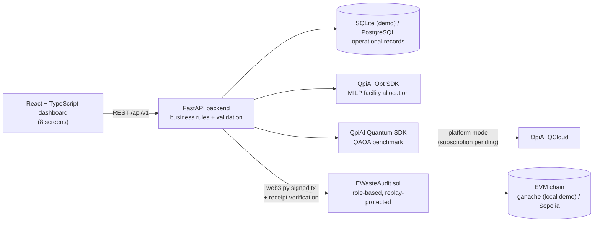

# E-Waste Ledger

**Traceable e-waste recovery, physical mass-balance auditing and fraud-resistant material claims, anchored on an EVM blockchain and optimized with QpiAI.**

> Quant-A-Maze 3.0 · Q-BITS × QpiAI · **Web3 & Blockchain track** · Problem statement **WEB3-02: E-Waste Collection, Recovery Yields and Auditable Material Claims**
> Team: `Chaos Coders` · Members: `Poornima H A , Muskhan B S , D Kirthana`

---

## 1. The problem

E-waste moves through collection centres, transporters and licensed recyclers. At every handover, quantities can be misreported, shipments can go missing, licences can lapse, and the same recovered material can be claimed more than once. Paper and spreadsheet records make independent verification almost impossible.

## 2. What E-Waste Ledger answers

| Question | How the platform answers it |
|---|---|
| Where did this batch originate? | Batch passport with source, weighing evidence and full split/merge lineage |
| Who handled it, and are handovers missing? | Chain of custody with independent dispatch/receipt weights, mismatch and overdue-handover detection |
| How much entered processing, and how much was recovered? | Physical mass-balance engine: input = recovered + residual + loss + WIP + unexplained |
| Are any recovery claims duplicated or physically impossible? | Recovery Integrity Gate: atomic over-claim prevention, duplicate-ID and evidence-reuse detection, implausible-run blocking |
| Can an auditor verify the entire history? | SHA-256 hash-chained events per batch, anchored on-chain, re-verified independently against the database |
| Where should each batch go? | QpiAI Opt solves facility allocation under capacity, licence and category constraints |

## 3. Key results (demo dataset, all reproducible)

| Area | Result | Evidence |
|---|---|---|
| QpiAI Opt dispatch allocation (6 batches × 4 recyclers) | `optimal` / **`global_optimum`**; **6/6 batches placed vs 5/6** for nearest-facility baseline; **₹5.89 vs ₹6.39 per kg placed (7.82% lower)** | `evidence/solver_runs/allocation_local_*.json` |
| Independent check of solver output | Solver objective equals our own recomputed cost; every assignment re-validated for capacity, licence and category | same file, `objective_matches_independent_cost: true` |
| QAOA benchmark (same formulation, 8-qubit sub-instance with a binding capacity constraint) | QAOA result **matches MILP and exhaustive brute force (₹6,150)**; reported as `best_found`, never as proven optimal | `evidence/solver_runs/qaoa_local_*.json` |
| Smart contract security | Replay rejected, unauthorised writer rejected, on-chain head equals DB head | `evidence/blockchain_receipts/anchor_test_*.json` |
| Automated tests | **30/30 passed** (custody, hash chain, mass balance, claims, race condition, inventory, lineage, costs, allocation) | `evidence/test_report.xml` |

> Numbers in the live app's **Impact & Evidence** page are computed from the database and evidence files at request time; nothing is hard-coded.

## 4. Architecture



**Separation of responsibilities**

- **React** displays data and collects input. It never decides whether a claim is valid.
- **FastAPI** enforces every business rule (custody, compliance, mass balance, claims, lineage), even if the UI is bypassed.
- **The database** stores operational records with integer-gram masses and integer-paise costs (no float accounting).
- **The smart contract** stores only hashes: batch audit-chain heads and approved plan hashes.
- **QpiAI** makes the dispatch decision; our own verifier re-checks it before anything is approved.

### End-to-end flow

`Collect → Optimize dispatch (QpiAI Opt) → Approve & anchor plan → Dispatch → Receive → Process (mass balance) → Claim (Integrity Gate) → Reconcile inventory → Audit & export`

## 5. QpiAI integration (exact and honest)

| Component | What we did | Status |
|---|---|---|
| **QpiAI Opt SDK** (`qpiai-opt`) | Binary MILP: `x[i,j] = 1` if batch *i* goes to facility *j*. Minimize transport + processing cost subject to one-facility-per-batch, capacity, and **hard** eligibility (ineligible pairs get no variable). Solved with `solve(model, client=Client(api_key))`, key-authenticated. | ✅ Executed, `global_optimum` |
| Baseline + verification | Nearest-eligible-facility greedy baseline on identical data; independent feasibility checker re-validates every solver assignment. | ✅ |
| **QpiAI Quantum SDK** (`qpiai-quantum`, via `qpiai-opt[quantum]`) | Same model → `QUBOProblem.from_model` → `QAOA(reps=2)`. Exact presolve removes a non-binding capacity row; capacity scaled to 100 kg units (exact for these masses) to keep slack qubits low: **8 qubits, depth 21**. Compared with MILP and brute force. | ✅ Executed on the QpiAI **local** statevector simulator (QCloud-key authenticated) |
| **QpiAI QCloud** (platform mode) | Key verified; 6 compute resources listed (incl. QpiAI-Indus-1); experiment `ewaste-qaoa-benchmark` created and resolved; **QAOA circuit uploaded** (`circuit_id 08bbd945-77fc-4cf1-ab1a-2544cc8d14bb`). Job creation returned *"an active subscription is required to run jobs"*. | ⏸️ Awaiting account subscription, documented in `docs/qpiai-execution-log.md` |
| Opt platform mode | `mode="platform"` returned *"no active storage quota found for organization"*. | ⏸️ Awaiting quota |

We do **not** claim quantum advantage, and we do not claim the QAOA run executed on QCloud hardware.

## 6. Blockchain design

**On-chain (tamper-evident):** batch audit-chain head hash + event count, approved QpiAI dispatch-plan hash + scenario hash, attestor address, block timestamp.
**Off-chain (controlled DB):** weights, materials, costs, licences, addresses, evidence documents (only their SHA-256 goes on-chain), solver inputs/outputs.

`contracts/src/EWasteAudit.sol`:

| Function | Guarantee |
|---|---|
| `anchorBatchHead(batchId, headHash, eventCount)` | `onlyAttestor`; `eventCount` must strictly increase → replay and rollback rejected |
| `anchorPlan(planHash, scenarioHash, runId)` | `onlyAttestor`; each plan hash anchors once |
| `setAttestor(account, allowed)` | `onlyAdmin` role management |
| `getBatchAnchor(batchId)` | Public read for independent verification |

**Verification never trusts the UI.** `GET /api/v1/blockchain/batches/{id}/verify` recomputes the SHA-256 chain from the database, reads the anchor from the chain, compares them, and re-fetches the transaction receipt (status, contract address). Status is shown as `verified`, `mismatch` or `not_anchored`. Transactions are recorded as `pending → confirmed / failed`; nothing is labelled verified until checked on-chain.

> A hash proves a record was not altered after it was committed. It does **not** prove the original weighing was truthful; that depends on calibrated equipment and procedures.

## 7. Integrity rules enforced by the backend

| Area | Rule |
|---|---|
| Custody | Dispatch and receipt weights stored independently and never overwritten; gap > 0.5% raises an alert (> 2% critical); receipt only by the intended receiver; duplicate receipt rejected; overdue dispatch → missing handover |
| Compliance | Dispatch to an expired-licence or category-unauthorised facility is blocked; the optimizer excludes them as hard constraints |
| Hash chain | Every event (registration, dispatch, receipt, processing, claim, cost, lineage, alert review) is SHA-256 chained to the previous one |
| Mass balance | Variance ≤ 1% pass, ≤ 3% warning, > 3% critical; outputs exceeding input flagged as physically impossible; processor input exceeding received mass flagged |
| Integrity Gate | (1) claim ID unique, (2) source run's mass balance not critical, (3) evidence hash not already used, (4) **atomic conditional UPDATE** so concurrent requests cannot over-allocate |
| Inventory | System (derived from movements) vs independent physical count vs claimed; `STOCK_SHORTFALL`, `UNRECORDED_STOCK`, `GHOST_INVENTORY`; disputed receipts excluded from confirmed stock |
| Lineage | Split: children ≤ parent mass, loss ≤ 0.5%; merge: same facility and category; disputed batches cannot be split/merged; each child records its parent's chain-head hash |
| Governance | Alert reviews `open → investigating → resolved / false_positive` with reviewer and mandatory note, hash-chained; closed alerts cannot be reopened; reviews never alter measurements |

All thresholds are **demonstration values**, not validated operating standards.

## 8. Repository structure

```
e-waste-ledger/
├── backend/
│   ├── app/
│   │   ├── main.py                 # core API: batches, custody, audits, optimization endpoints
│   │   ├── models.py, db.py        # SQLAlchemy models + session
│   │   ├── allocation.py           # QpiAI Opt model, baseline, independent verifier
│   │   ├── blockchain.py           # anchoring, receipts, independent verification
│   │   ├── recovery.py             # processing runs, mass balance, Integrity Gate
│   │   ├── inventory.py            # system vs physical vs claimed reconciliation
│   │   ├── costs.py                # batch cost records, cost per kg
│   │   ├── lineage.py              # split / merge with mass conservation
│   │   ├── governance.py           # alert reviews + live metrics
│   │   └── optimization_routes.py  # scenario + QAOA benchmark summaries
│   ├── scripts/reset_demo.py       # one-command clean demo dataset (via the real API)
│   └── tests/                      # pytest suite (isolated test database)
├── frontend/src/                   # React + TypeScript + Tailwind
├── contracts/
│   ├── src/EWasteAudit.sol
│   ├── deploy.py, anchor_test.py   # compile/deploy with py-solc-x + web3.py
│   └── abi/, deployment.json
├── optimization/
│   ├── fixtures/demo_scenario.json
│   ├── run_allocation.py           # QpiAI Opt run + evidence
│   └── qaoa_benchmark.py           # QAOA vs MILP vs brute force
├── evidence/                       # solver runs, blockchain receipts, test report
└── docs/                           # execution log, architecture, demo script
```

## 9. Setup

**Prerequisites:** Python 3.10+, Node.js, Git. QpiAI Opt and QCloud API keys from https://opt.qpiai.tech and https://qcloud.qpiai.tech.

```powershell
# backend
cd backend
py -m venv .venv
.\.venv\Scripts\python.exe -m pip install -r requirements.txt
copy .env.example .env      # then fill in your keys

# frontend
cd ..\frontend
npm install                 # .npmrc sets legacy-peer-deps=true
```

`backend/.env` variables:

| Variable | Purpose |
|---|---|
| `QPIAI_OPT_API_KEY` | QpiAI Opt authentication |
| `QPIAI_QCLOUD_API_KEY` | QpiAI Quantum SDK / QCloud authentication |
| `DATABASE_URL` | Defaults to `sqlite:///./ewaste.db`; set a PostgreSQL URL for production |
| `RPC_URL` | EVM RPC endpoint (`http://127.0.0.1:8545` for ganache) |
| `CHAIN_PRIVATE_KEY` | **Testnet-only** attestor key. Never commit `.env`. |

## 10. Run the demo

Four terminals:

```powershell
# 1. local chain
npx ganache --chain.chainId 1337 --wallet.deterministic

# 2. clean demo data (deploys a fresh contract, seeds through the API, anchors, runs QpiAI Opt), then the API
cd backend
.\.venv\Scripts\python.exe scripts\reset_demo.py
.\.venv\Scripts\python.exe -m uvicorn app.main:app --reload

# 3. dashboard
cd frontend
npm run dev                 # http://localhost:5173

# 4. tests (isolated database)
cd backend
.\.venv\Scripts\python.exe -m pytest tests -v --junitxml=..\evidence\test_report.xml
```

Reproduce the QpiAI evidence:

```powershell
.\backend\.venv\Scripts\python.exe .\optimization\run_allocation.py
.\backend\.venv\Scripts\python.exe .\optimization\qaoa_benchmark.py
.\backend\.venv\Scripts\python.exe .\contracts\anchor_test.py
```

### Seeded demo scenarios

| Batch | Scenario |
|---|---|
| EW-2026-0001 | Clean flow: 500 kg, processed (PASS, 5 kg / 1.0% unexplained, 48% yield), copper claimed, costed, reconciled, anchored |
| EW-2026-0002 | Missing handover: dispatched to F4, never received |
| EW-2026-0003 | Weight mismatch: 500 kg sent, 492 kg received → disputed |
| EW-2026-0004 | 500 kg at F1, ready for live processing and the fraud demo |
| EW-2026-0005 / 0006 | CONSUMER batches at CC-B, ready for a live merge |

## 11. Main API endpoints

| Method | Endpoint | Purpose |
|---|---|---|
| POST / GET | `/api/v1/batches`, `/api/v1/batches/{id}` | Register / batch passport |
| GET | `/api/v1/batches/{id}/verify-chain` | Recompute off-chain hash chain |
| POST | `/api/v1/transfers`, `/api/v1/transfers/{id}/receive` | Dispatch / receipt |
| POST | `/api/v1/batches/{id}/split`, `/api/v1/batches/merge` | Lineage |
| POST | `/api/v1/optimization/solve`, `/api/v1/optimization/runs/{id}/approve` | QpiAI Opt plan / approve + anchor |
| POST | `/api/v1/processing-runs` | Processing + mass balance |
| POST | `/api/v1/claims` | Recovery Integrity Gate |
| GET / POST | `/api/v1/inventory/reconciliation`, `/api/v1/inventory/counts` | Reconciliation / physical count |
| POST | `/api/v1/costs` | Cost records |
| POST / GET | `/api/v1/blockchain/batches/{id}/anchor`, `/verify` | Anchor / independent verification |
| POST | `/api/v1/audits/alerts/{id}/resolve` | Alert review workflow |
| GET | `/api/v1/metrics` | Live impact metrics |

Interactive docs: http://127.0.0.1:8000/docs

## 12. Limitations

- Facility licences, distances, costs and batches are **clearly labelled demo data**, not government-verified records.
- The live demo runs on a **local ganache chain**; the same scripts deploy to Sepolia once funded (`RPC_URL` + key).
- QAOA executed on the QpiAI local simulator; QCloud execution awaits an account subscription.
- Hashes and anchors prove records were not altered; they cannot prove a weighing was honest without calibrated, tamper-resistant measurement.
- The overdue-handover threshold is shortened to 3 minutes for the demo (`OVERDUE_HOURS`).
- SQLite is used for the demo; the conditional-update allocation logic is designed for PostgreSQL in production.

## 13. Roadmap

Calibrated weighbridge integration (signed readings), verified facility credentials from regulator records, PostgreSQL + background anchoring queue, Sepolia/mainnet L2 deployment, QCloud execution at larger scales once available, and role-based authentication per organization.

## 14. Credits

Built for Quant-A-Maze 3.0 (Q-BITS × QpiAI). QpiAI SDKs are used under their Apache-2.0 licences.